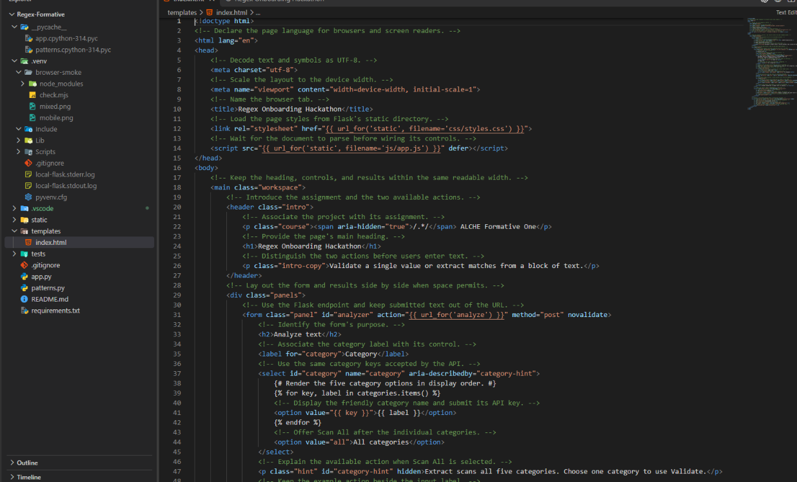
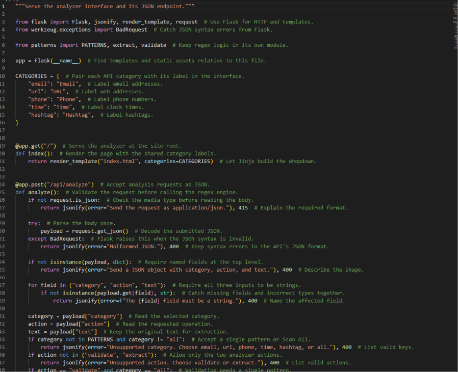

# Regex Onboarding Hackathon

This individual ALCHE Formative One project validates and extracts email addresses, URLs, phone numbers, times, and hashtags. Flask serves the page and uses Python's built-in regex engine for both actions. Vanilla JavaScript sends the form as JSON with `fetch()` and displays the response on the same page. Submissions are processed in memory.

- **Validate** trims surrounding whitespace and uses `fullmatch()` to check the whole input against one category.
- **Extract** uses `finditer()` on the original text and returns matches in source order. Select **All categories** to run the five patterns over the same input and see a count for each category.
- The **Highlighted preview** preserves the original text and line breaks. Overlapping matches still appear in the results. In the preview, the earliest start wins. If two starts are equal, the longer match wins.

## Screenshots

**Analyzer page template** (`templates/index.html`)



**Flask routes and request validation** (`app.py`)



## Run locally in Windows Git Bash

Install Python 3.10 or newer and open Git Bash in the project folder.

```bash
python -m venv .venv
source .venv/Scripts/activate
python -m pip install -r requirements.txt
python -m flask --app app run
```

Open [http://127.0.0.1:5000](http://127.0.0.1:5000) in your browser. Gunicorn is included for Render. The Flask development server is the local entry point on Windows.

## Run the tests

With the virtual environment active, run this from the project folder.

```bash
python -m unittest discover -s tests -v
```

The regex tests cover accepted and rejected formats, extraction order, punctuation, and malformed fragments. The Flask tests cover the homepage, JSON errors, empty results, Scan All, overlapping matches, and Python offsets after an emoji.

## Supported formats

| Category | Sample input | Validate | Extract |
| --- | --- | --- | --- |
| Email | `firstname.lastname@company.co.uk` | Valid | `firstname.lastname@company.co.uk` |
| URL | `Visit https://subdomain.example.org/page?q=a.b#part.` | Invalid | `https://subdomain.example.org/page?q=a.b#part` |
| Phone | `(123) 456-7890` | Valid | `(123) 456-7890` |
| Time | `2:30 PM` | Valid | `2:30 PM` |
| Hashtag | `#Regex_101` | Valid | `#Regex_101` |

- **Email** accepts dot-separated local segments made of ASCII letters, digits, underscores, plus signs, percent signs, or hyphens. The domain uses dotted ASCII DNS labels and an alphabetic suffix of at least two letters. Quoted local parts and Unicode addresses are outside the supported format.
- **URL** accepts HTTP and HTTPS with dotted DNS-style hosts and optional paths, queries, and fragments. Extraction removes surrounding prose punctuation and keeps punctuation inside the URL, including balanced, non-nested parentheses. Use percent encoding for spaces and literal brackets. Localhost, IP addresses, credentials, and numeric ports are outside the supported format.
- **Phone** accepts `(123) 456-7890`, `123-456-7890`, and `123.456.7890`. Both separators must agree in unparenthesized numbers. Country codes and extensions are outside the supported format.
- **Time** accepts 24-hour `HH:MM` or 12-hour `H:MM AM` / `H:MM PM` with an optional leading zero. AM and PM are case-insensitive and require preceding horizontal whitespace. Hours and minutes must be in range. Seconds are outside the supported format.
- **Hashtag** accepts a hash followed by one or more ASCII letters, digits, or underscores. A tag cannot begin immediately after a word character or another hash. A hyphen ends a tag, so `#hello-world` fails Validate and Extract returns `#hello`.

## Scan All example

Select **All categories**, click **Try example**, and click **Extract**.

```text
Contact user@example.com or visit https://www.example.com/help.
Call (123) 456-7890 at 2:30 PM. Follow #RegexHackathon.
```

| Category | Count | Expected match |
| --- | ---: | --- |
| Email | 1 | `user@example.com` |
| URL | 1 | `https://www.example.com/help` |
| Phone | 1 | `(123) 456-7890` |
| Time | 1 | `2:30 PM` |
| Hashtag | 1 | `#RegexHackathon` |

For a preview check, extract `🚀 user@example.com` under **Email**. The highlight starts at `user` and ends at `.com`. For an overlap check, extract `https://example.org/#Demo` under **All categories**. The URL and `#Demo` appear in their respective result groups, and the preview highlights the whole URL.

## API

`GET /` serves the interface. Send JSON to `POST /api/analyze` with three string fields.

| Field | Accepted values |
| --- | --- |
| `category` | `email`, `url`, `phone`, `time`, `hashtag`, or `all` |
| `action` | `validate` or `extract`. Use `all` with `extract`. |
| `text` | The text to analyze. Whitespace-only input is rejected. |

Validate one email address.

```bash
curl -s http://127.0.0.1:5000/api/analyze \
  -H 'Content-Type: application/json' \
  -d '{"category":"email","action":"validate","text":" user@example.com "}'
```

```json
{"action":"validate","category":"email","valid":true}
```

Extract every supported category from text.

```bash
curl -s http://127.0.0.1:5000/api/analyze \
  -H 'Content-Type: application/json' \
  -d '{"category":"all","action":"extract","text":"At 2:30 PM."}'
```

```json
{
  "action": "extract",
  "category": "all",
  "matches": [{"category": "time", "value": "2:30 PM", "start": 3, "end": 10}]
}
```

The offsets count Unicode code points in the original Python string. `start` is zero-based and inclusive, and `end` is exclusive. JavaScript converts both to UTF-16 code units before slicing the input. A successful extraction with zero matches returns `"matches": []`. Errors have an `error` string. Invalid JSON or fields return HTTP 400, and a non-JSON media type returns HTTP 415.

## Project layout

```text
alu_regex-data-extraction-kofiannan06/
├── app.py                     Flask routes and request checks
├── patterns.py                Compiled patterns, validation, and extraction
├── templates/
│   └── index.html             Analyzer page
├── static/
│   ├── css/styles.css         Responsive layout and category colors
│   └── js/app.js              Form actions, result groups, and preview
├── tests/
│   ├── test_patterns.py       Regex behavior and edge cases
│   └── test_app.py            Flask route and API tests
├── requirements.txt           Flask and Gunicorn
├── .gitignore
└── README.md
```

## Publish and deploy

1. Verify that your ALU email is added and verified in [GitHub email settings](https://github.com/settings/emails).
2. Create an empty GitHub repository named `alu_regex-data-extraction-kofiannan06`. If your GitHub username has changed, use `alu_regex-data-extraction-{YourUsername}` and update the remote URL below. GitHub's instructions cover adding an existing local repository. [GitHub Docs](https://docs.github.com/en/migrations/importing-source-code/using-the-command-line-to-import-source-code/adding-locally-hosted-code-to-github)
3. From Git Bash in the project folder, link the empty repository and push the local commits.

   ```bash
   git remote add origin https://github.com/kofiannan06/alu_regex-data-extraction-kofiannan06.git
   git push -u origin main
   ```

4. In the Render dashboard, choose **New → Web Service**, connect the GitHub repository, and select the `main` branch. Use the settings below. [Render's Flask guide](https://render.com/docs/deploy-flask)

   | Setting | Value |
   | --- | --- |
   | Language | Python 3 |
   | Root directory | Leave blank |
   | Build command | `pip install -r requirements.txt` |
   | Start command | `gunicorn app:app` |
   | Instance type | Free for the assignment demo |

5. After Render reports a successful deploy, open the service's public `onrender.com` URL. Try Validate and the Scan All example on the live site, then submit that URL in the assignment portal.
